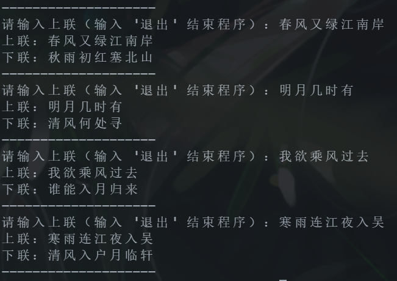
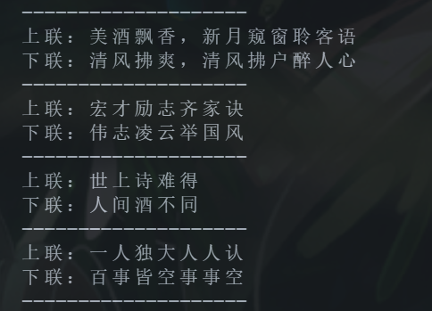
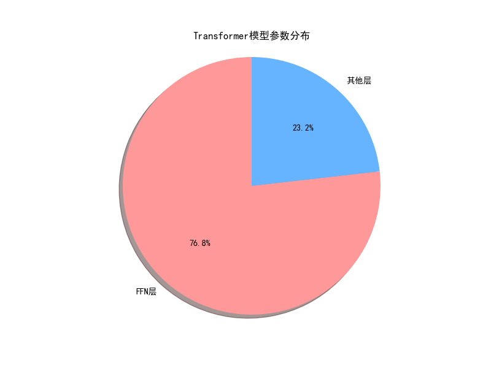

# 基于Transformer的中文对联生成系统

本项目实现了一个基于Transformer架构的中文对联生成模型，支持字符级和词级分词方式，能够根据输入的上联自动生成匹配的下联。模型采用标准的Encoder-Decoder结构，并加入了针对对联生成任务的特殊优化。

## 模型架构

- **Encoder**: 4层Transformer编码器，每层包含：
  - 多头自注意力机制(4个头)
  - 前馈网络(d_model=256, d_ff=2048)
  - 残差连接和Layer Normalization
  - Dropout=0.1

- **Decoder**: 4层Transformer解码器，每层包含：
  - 带掩码的多头自注意力机制
  - 编码器-解码器注意力机制
  - 前馈网络
  - 残差连接和Layer Normalization

- **投影层**: 线性层将decoder输出映射到目标词汇表空间

- **MoE层**: 可选使用Mixture of Experts结构(4个专家)

## 安装

```bash
git clone [项目地址]
cd [项目目录]
pip install -r requirements.txt
```

## 数据准备

1. 准备训练数据：将对联数据保存为CSV格式，每行格式为"上联 下联"
2. 数据文件放在`couplet/`目录下：
   - `train.csv`: 完整训练集
   - `train_mini.csv`: 小型训练集(用于测试)

## 训练模型

```bash
python train.py
```

### 训练参数
可在`config/config.py`中调整：
- **模型参数**:
  - `d_model`: 模型维度(默认256)
  - `d_ff`: 前馈网络维度(默认2048)
  - `n_layers`: Transformer层数(默认4)
  - `n_heads`: 注意力头数(默认4)
  - `dropout`: Dropout率(默认0.1)
  - `use_moe`: 是否使用Mixture of Experts(默认True)
  
- **训练参数**:
  - `num_epochs`: 训练轮次(默认10)
  - `batch_size`: 批大小(默认128)
  - `learning_rate`: 学习率(默认1e-4)
  - `tokenization_type`: 分词方式('char'/'word'/'jieba')

- **数据参数**:
  - `train_path`: 训练数据路径
  - `src_len`: 最大上联长度
  - `tgt_len`: 最大下联长度

### 训练过程
1. 数据预处理：构建词汇表，转换为索引序列
2. 初始化模型和优化器(Adam)
3. 使用交叉熵损失函数
4. 每epoch保存模型和训练日志

训练完成后，模型和词汇表将保存在：
- `weights/train_1/couplet_model.pth`: 模型权重
- `vocab/train_1/`: 词汇表文件

## 项目结构

```
.
├── config/                # 配置文件
│   ├── __init__.py
│   └── config.py          # 模型和训练参数
├── couplet/               # 对联数据集
│   ├── train.csv
│   └── train_mini.csv
├── models/                # 模型定义
│   ├── attention.py       # 注意力机制
│   ├── couplet_specific_layer.py 
│   ├── decoder.py         # 解码器
│   ├── encoder.py         # 编码器
│   ├── feed_forward.py    # 前馈网络
│   └── transformer.py     # Transformer模型
├── utils/                 # 工具函数
│   ├── beam_search.py     # Beam Search解码
│   ├── data_loader.py     # 数据加载
│   ├── tools.py           # 辅助工具
│   └── vocab_builder.py   # 词汇表构建
├── vocab/                 # 词汇表
├── weights/               # 模型权重
├── generate.py            # 生成对联脚本
├── param_analysis.py      # 模型参数分析
├── play.py                # 交互式生成
├── train.py               # 训练脚本
└── README.md              # 项目说明
```

## 项目使用

> 注意，在使用前，先在config/config.py中修改训练参数

1. 训练模型：
```bash
python train.py
```
2. 生成对联（测试）：
```bash
python generate.py
```
3. 交互式生成：
```bash
python play.py
```

## 使用示例



